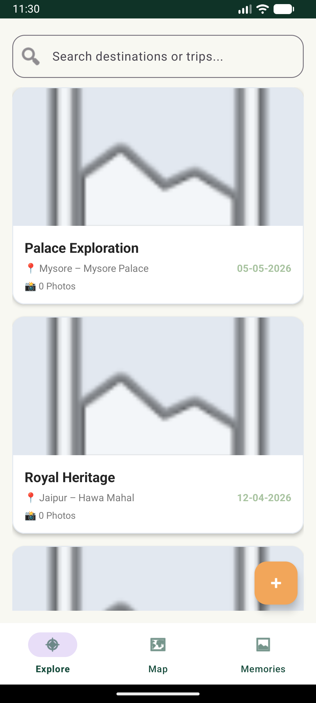
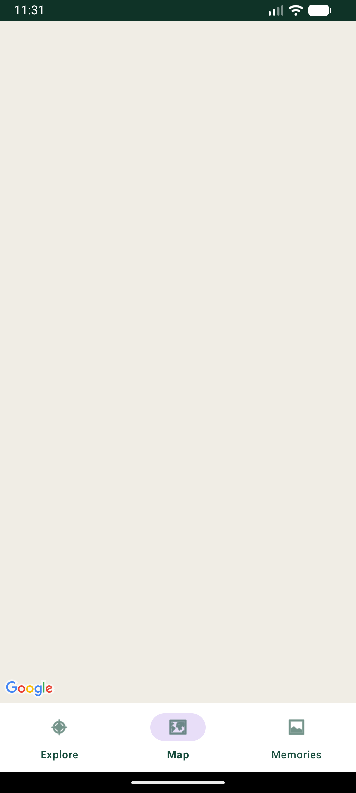

# CA-2: TripJournal – Travel Diary & Photo Gallery 🧭📷

A premium, modern travel-inspired Android application built for travellers to record visited destinations, add travel notes & dates, attach multiple photographs, and view travel history interactively on a map.

---

## 📱 App Screenshots

| 1. Splash Screen | 2. Explore (Trip List) | 3. Map View | 4. Memories Gallery |
| :---: | :---: | :---: | :---: |
|  |  |  |  |

---

## 🎨 Design System & Color Palette
- **Primary Color**: `#174C3C` (Deep Forest Green)
- **Secondary Color**: `#A8C3A0` (Sage Green)
- **Background**: `#F8F8F2` (Warm Off-white)
- **Card Background**: `#FFFFFF` (White)
- **Accent Color**: `#F2A65A` (Warm Amber)
- **Primary Text**: `#242424`
- **Secondary Text**: `#777777`

---

## 🚀 Key Features & Requirements Demonstrated

1. **Splash Screen (`SplashActivity.kt`)**:
   - Displays the TripJournal logo, application name, tagline *"Every journey deserves a memory."*, and warm travel background before navigating to `MainActivity`.

2. **Home Screen / Explore Section (`ExploreFragment.kt`)**:
   - Displays all saved trips from SQLite in a modern `RecyclerView` with destination cards.
   - Real-time search bar filtering trips by title, location, or notes.
   - Floating Action Button (+) to record new trips (`AddTripActivity`).
   - Attractive empty state (*"No journeys recorded yet."* + *"Start Your First Journey"* button).
   - Automatically seeds 5 sample travel entries on first launch:
     1. Goa – Baga Beach
     2. Manali – Solang Valley
     3. Bangalore – Lalbagh Botanical Garden
     4. Jaipur – Hawa Mahal
     5. Mysore – Mysore Palace

3. **Add & Edit Trip Screen (`AddTripActivity.kt` & `EditTripActivity.kt`)**:
   - Location selection via interactive Google Map / Location Picker (`MapActivity.kt`) supporting long-press coordinate capturing.
   - Date picker dialog (`DatePickerDialog`), title, location, notes, multi-photo picker (`ACTION_GET_CONTENT`), and cover photo selection.

4. **Trip Details Screen (`TripDetailsActivity.kt`)**:
   - Displays large cover photograph, title, location, date, notes, coordinates, and photo count.
   - Photo gallery grid (`PhotoAdapter`), full-screen photo viewer (`ImageViewerActivity.kt`), and Edit/Delete trip actions with cascading photo deletion.

5. **Map View Section (`MapFragment.kt`)**:
   - Displays all saved trip locations as interactive Google Map markers.
   - Tapping a marker shows trip details and a View Details action.
   - Automatically computes bounds and zooms camera to fit all saved markers (`LatLngBounds.Builder`).

6. **Memories Section (`MemoriesFragment.kt`)**:
   - Displays photographs from all saved trips in a unified photo gallery grid.

7. **SQLite Database Implementation (`TripDatabaseHelper.kt`)**:
   - Relational database schema with `trips` and `photos` tables linked by `trip_id` (`ON DELETE CASCADE`).
   - Complete CRUD methods: `insertTrip()`, `getAllTrips()`, `getTripById()`, `updateTrip()`, `deleteTrip()`, `insertPhoto()`, `getPhotosByTripId()`, `deletePhoto()`, `deletePhotosByTripId()`.

---

## 📁 Project Structure

```
CA-2/
├── README.md                             # Complete documentation & screenshots
├── build.gradle
├── settings.gradle
├── gradle.properties
├── local.properties
├── gradlew & gradlew.bat
├── screenshots/                          # App screenshots
│   ├── splash_screen.png
│   ├── explore_list.png
│   ├── map_view.png
│   └── memories_gallery.png
└── app/
    ├── build.gradle                      # Module dependencies (Google Maps, RecyclerView, Material 3)
    └── src/main/
        ├── AndroidManifest.xml
        ├── java/com/example/tripjournal/
        │   ├── activities/
        │   │   ├── SplashActivity.kt
        │   │   ├── MainActivity.kt
        │   │   ├── AddTripActivity.kt
        │   │   ├── TripDetailsActivity.kt
        │   │   ├── EditTripActivity.kt
        │   │   ├── MapActivity.kt
        │   │   └── ImageViewerActivity.kt
        │   ├── adapters/
        │   │   ├── TripAdapter.kt
        │   │   └── PhotoAdapter.kt
        │   ├── database/
        │   │   └── TripDatabaseHelper.kt
        │   ├── models/
        │   │   ├── Trip.kt
        │   │   └── Photo.kt
        │   └── fragments/
        │       ├── ExploreFragment.kt
        │       ├── MapFragment.kt
        │       └── MemoriesFragment.kt
        └── res/
            ├── drawable/                 # Vector icons & background shapes
            ├── layout/                   # XML layouts for activities, cards, fragments
            └── values/                   # Colors, strings, themes
```

---
**Developer:** Mrigank Shukla  
**USN:** 25MCAR0109
