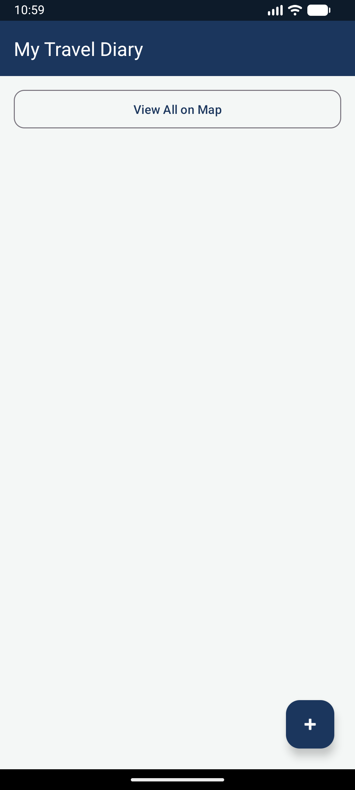

# CA2-TripJournal – Travel Diary & Photo Gallery 🧭📷

An advanced Android application built for travellers to record visited places, attach travel notes & dates, manage photo galleries for each location, and revisit everything interactively on a **Google Map**.

---

## 📱 App Screenshots

| 1. Trip List Screen | 2. Add Trip Screen | 3. Trip Details & Gallery | 4. Map View Overview |
| :---: | :---: | :---: | :---: |
|  |  |  |  |

---

## 🚀 Key Features & Requirements Demonstrated

1. **Trip List Screen (`MainActivity.kt`)**:
   - Displays all saved trips (title, place, date, cover photo) in a modern `RecyclerView` (`item_trip.xml`).
   - Floating Action Button (FAB) to add a new trip.
   - Quick action buttons to edit, delete, or view trip details and view all trips on a map.

2. **Add / Edit Trip Screen (`AddTripActivity.kt`)**:
   - Integrated **Google Maps API**: User long-presses anywhere on the map to pick exact visit coordinates (`latitude` and `longitude`).
   - Input fields for trip title, place name, date, and journal notes.
   - Cover photo picker via `ACTION_GET_CONTENT` with live preview.
   - Saves all data to SQLite database.

3. **Trip Details & Photo Gallery (`TripDetailActivity.kt`)**:
   - Displays full trip information, journal notes, and cover photo.
   - Photo gallery grid (`PhotoGalleryAdapter`) showing multiple photos attached to that location.
   - Ability to add new photos using `ACTION_GET_CONTENT`, view photos full-size (`FullScreenPhotoActivity`), or delete photos.

4. **Map View Screen (`MapOverviewActivity.kt`)**:
   - Displays an interactive Google Map with markers for every visited place.
   - Tapping any marker shows the trip title, location snippet, and date.
   - Automatically computes bounds and zooms the camera to fit all markers (`LatLngBounds.Builder`).

5. **SQLite Database (`DatabaseHelper.kt`)**:
   - Relational database schema with `trips` table and `photos` table linked by `trip_id` with `ON DELETE CASCADE`.
   - Complete CRUD operations for trips and associated photo URIs.

---

## 📁 Project Structure

```
CA2-TripJournal-Travel Diary & Photo Gallery/
├── build.gradle
├── settings.gradle
├── gradle.properties
├── local.properties
├── gradlew & gradlew.bat
├── screenshots/
│   └── trip_list.png
└── app/
    ├── build.gradle                      # Module dependencies (Google Maps, RecyclerView, Material 3)
    └── src/main/
        ├── AndroidManifest.xml           # Google Maps API key meta-data & location/storage permissions
        ├── java/com/tripjournal/app/
        │   ├── MainActivity.kt           # Trip List screen
        │   ├── AddTripActivity.kt        # Add/Edit trip with map long-press & photo picker
        │   ├── TripDetailActivity.kt     # Trip details & photo gallery manager
        │   ├── MapOverviewActivity.kt    # Map view screen with all trip markers & auto-zoom
        │   ├── FullScreenPhotoActivity.kt# Full-size photo viewer
        │   ├── adapters/
        │   │   ├── TripAdapter.kt        # RecyclerView adapter for trip list
        │   │   └── PhotoGalleryAdapter.kt# RecyclerView adapter for photo gallery
        │   ├── db/
        │   │   └── DatabaseHelper.kt     # SQLiteOpenHelper (trips & photos tables, CRUD)
        │   └── models/
        │       ├── Trip.kt               # Trip data model
        │       └── Photo.kt              # Photo data model
        └── res/
            ├── drawable/                 # Vector icons & launcher backgrounds
            ├── layout/                   # UI layouts for activities, cards, and items
            │   ├── activity_main.xml
            │   ├── activity_add_trip.xml
            │   ├── activity_trip_detail.xml
            │   ├── activity_map_overview.xml
            │   ├── activity_full_screen_photo.xml
            │   ├── item_trip.xml
            │   └── item_photo.xml
            └── values/                   # Colors, strings, themes
```

---
**Developer:** Mrigank Shukla  
**USN:** 25MCAR0109
