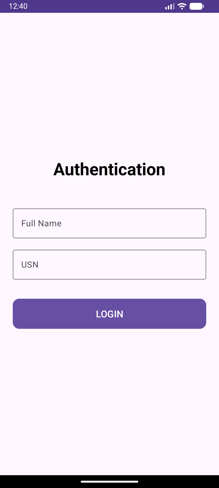
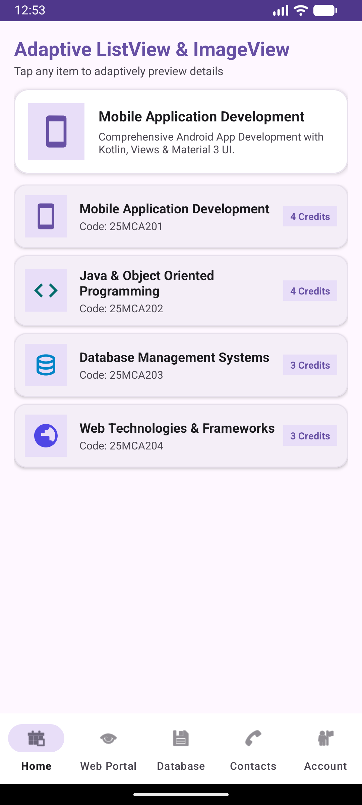
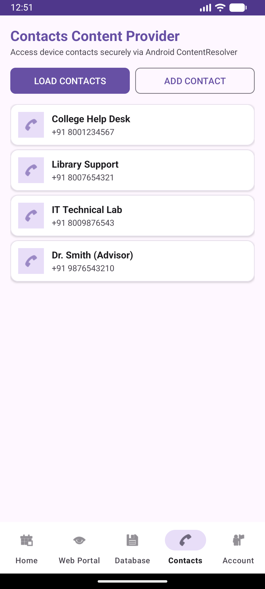
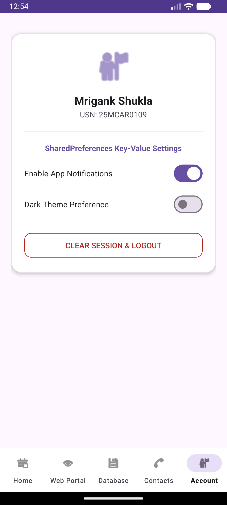

# Experiment 10: Implementing Data Sharing in Android by Using the Contacts Content Provider

## Overview
This experiment builds upon **Experiment 09** by incorporating **Android Content Providers** to enable secure inter-process data sharing. Specifically, it implements the **Contacts Content Provider** to query, display, and add device contacts using `ContentResolver`.

## Key Concepts & Implementation

### 1. Contacts Content Provider & ContentResolver (`ContactsFragment.kt`)
- **Runtime Permissions**: Requests `READ_CONTACTS` and `WRITE_CONTACTS` permissions securely at runtime on Android 6.0+.
- **Querying Content Provider**: Uses `ContentResolver` to query `ContactsContract.CommonDataKinds.Phone.CONTENT_URI`, extracting display names and phone numbers.
- **Data Rendering**: Populates a custom `ListView` via `ContactAdapter` and `item_contact_row.xml`.
- **Adding Contacts**: Integrates with the system contacts provider using `Intent(Intent.ACTION_INSERT)`.

### 2. Retained Architecture & Features (from Exp 09 & Exp 08)
- Material 3 Login & Session Management (`PreferenceManager.kt`)
- SQLite Database Manager (`DatabaseHelper.kt`)
- Adaptive ListView & ImageView (`HomeFragment.kt` & PopupMenu)
- Embedded WebView Portal (`WebViewFragment.kt`)

## Test Cases & Screenshots

### 1. Authentication Page
Session persisted via `SharedPreferences`.

### 2. Dashboard Home
Adaptive course catalog with PopupMenu integration.

### 3. Contacts Content Provider
Contacts tab querying system contacts securely through `ContentResolver`.

### 4. Account Settings & SharedPreferences
User profile and key-value preference toggles.

---
**Developer:** Mrigank Shukla  
**USN:** 25MCAR0109
