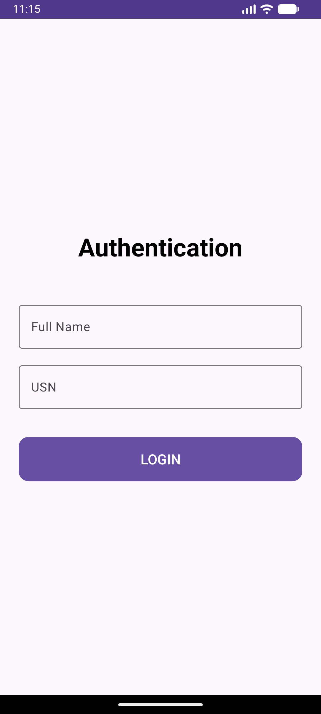
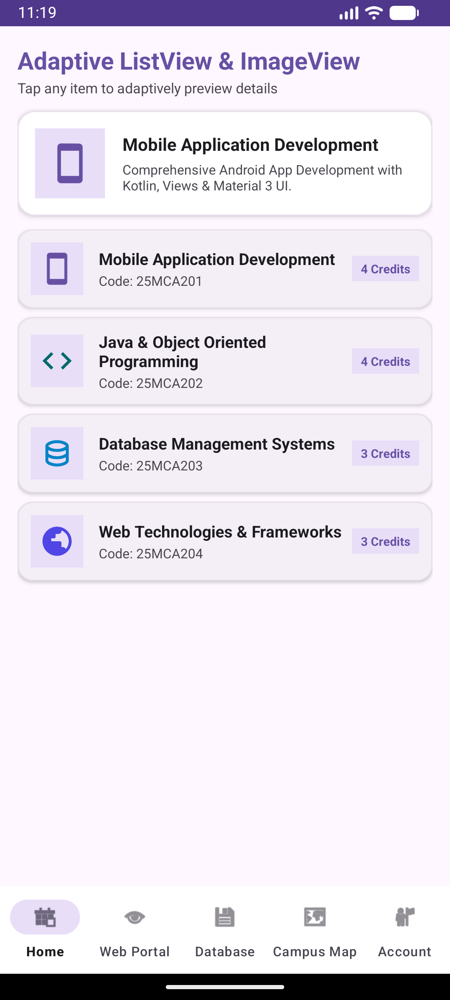
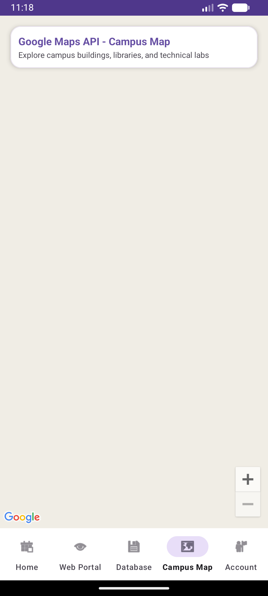
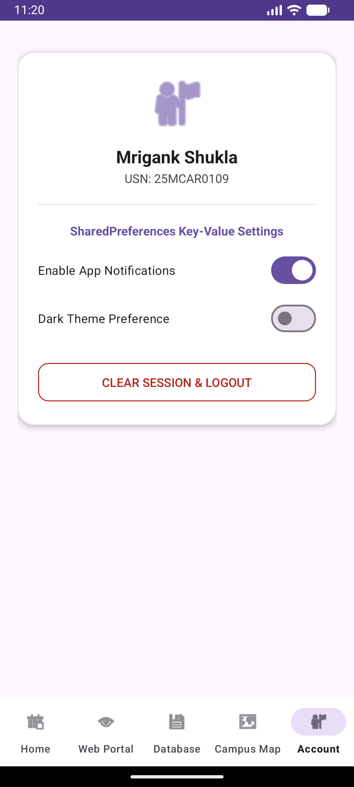

# Experiment 11: Developing an Application to Display a Map Using Google Maps API

## Overview
This experiment builds upon **Experiment 10** by integrating the **Google Maps SDK for Android**. It demonstrates embedding an interactive Google Map (`SupportMapFragment`), configuring API metadata and location permissions, moving camera positions, and adding custom markers for campus landmarks.

## Key Concepts & Implementation

### 1. Google Maps API Integration (`MapFragment.kt`)
- **Dependencies**: Integrated Google Play Services Maps (`play-services-maps`) and Location (`play-services-location`) in `app/build.gradle`.
- **API Key Configuration**: Declared Google Maps API key meta-data (`com.google.android.geo.API_KEY`) and location permissions (`ACCESS_FINE_LOCATION`, `ACCESS_COARSE_LOCATION`) in `AndroidManifest.xml`.
- **Map Initialization**: Implemented `OnMapReadyCallback` inside `MapFragment` to load `SupportMapFragment`.
- **Markers & Camera Animation**: Added custom map markers for university landmarks (Main Campus, Central Library, IT Technical Lab, Student Activity Center) and animated camera positioning (`CameraUpdateFactory.newLatLngZoom`).

### 2. Retained Architecture & Features (from Exp 10)
- Material 3 Login & Session Management (`PreferenceManager.kt`)
- SQLite Database Manager (`DatabaseHelper.kt`)
- Adaptive ListView & ImageView (`HomeFragment.kt` & PopupMenu)
- Embedded WebView Portal (`WebViewFragment.kt`)
- 5-tab Bottom Navigation (`Home`, `Web Portal`, `Database`, `Campus Map`, `Account`)

## Test Cases & Screenshots

### 1. Authentication Page
Session persisted via `SharedPreferences`.

### 2. Dashboard Home
Adaptive course catalog with PopupMenu integration.

### 3. Google Maps Campus Map
Interactive Google Map rendering university landmarks and zoom controls.

### 4. Account Settings & SharedPreferences
User profile and key-value preference toggles.

---
**Developer:** Mrigank Shukla  
**USN:** 25MCAR0109
