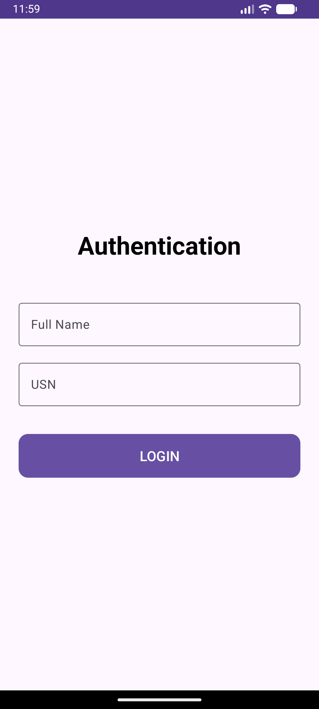
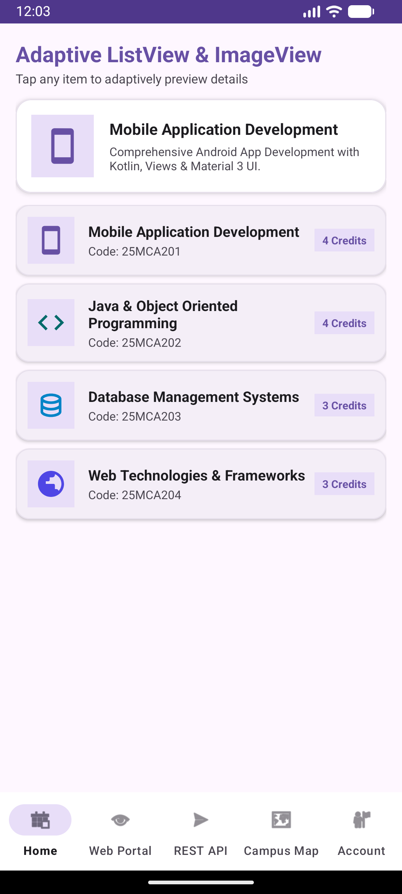
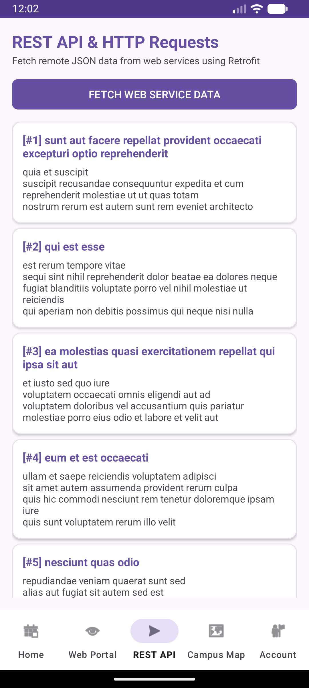
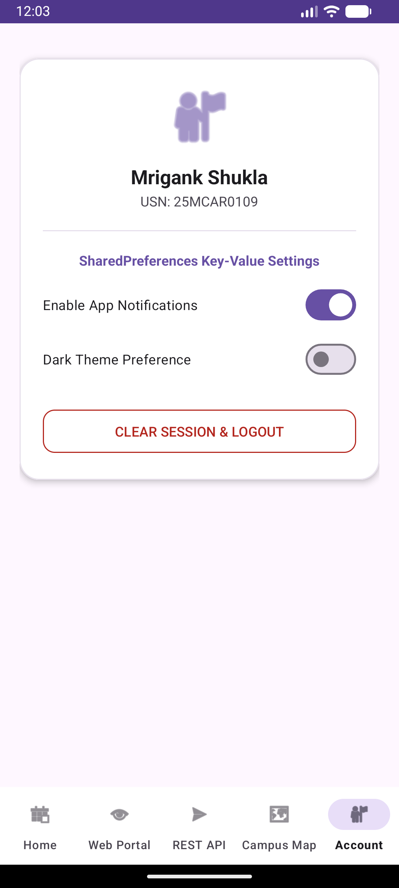

# Experiment 12: Implementing an Android Application to Access Web Services Using HTTP Requests

## Overview
This final experiment builds upon **Experiment 11** by integrating **Retrofit** and **Gson Converter** to perform asynchronous HTTP requests and access RESTful web services. It demonstrates fetching remote JSON data over the internet and rendering it efficiently inside a custom `ListView`.

## Key Concepts & Implementation

### 1. Web Services & HTTP Requests (`ApiFragment.kt`)
- **Dependencies**: Added Retrofit (`retrofit:2.9.0`) and Gson Converter (`converter-gson:2.9.0`) in `app/build.gradle`.
- **API Service Interface (`ApiService.kt`)**: Defines HTTP GET endpoints (e.g., fetching posts from `https://jsonplaceholder.typicode.com/posts`).
- **Retrofit Client (`RetrofitClient.kt`)**: Singleton configuration with base URL and Gson deserialization converter.
- **Asynchronous Execution**: Executes network calls on background threads with Retrofit's `.enqueue()`, displaying a loading progress indicator and populating `lvApiPosts` via `ApiPostAdapter`.

### 2. Retained Architecture & Features (from Exp 11)
- Google Maps API Campus Map (`MapFragment.kt`)
- Material 3 Login & Session Management (`PreferenceManager.kt`)
- SQLite Database Manager (`DatabaseHelper.kt`)
- Adaptive ListView & ImageView (`HomeFragment.kt` & PopupMenu)
- Embedded WebView Portal (`WebViewFragment.kt`)
- 5-tab Bottom Navigation (`Home`, `Web Portal`, `REST API`, `Campus Map`, `Account`)

## Test Cases & Screenshots

### 1. Authentication Page
Session persisted via `SharedPreferences`.

### 2. Dashboard Home
Adaptive course catalog with PopupMenu integration.

### 3. REST API & HTTP Requests
REST API tab fetching and rendering remote JSON posts via Retrofit HTTP requests.

### 4. Account Settings & SharedPreferences
User profile and key-value preference toggles.

---
**Developer:** Mrigank Shukla  
**USN:** 25MCAR0109
